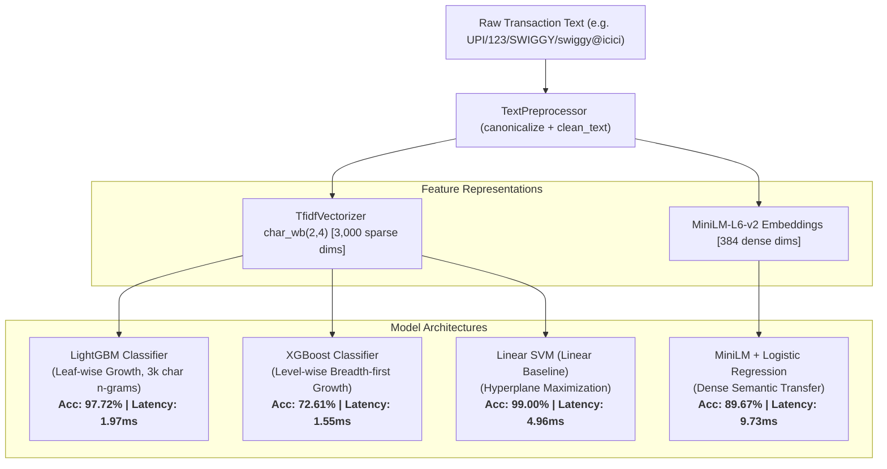

# AI Personal Finance Advisor: Multi-Model Evaluation Report (4 Model Families)

**Project Title**: Robust Transaction Categorization Engine for Personal Finance  
**Date**: October 13, 2026  
**Author**: Machine Learning Engineering & NLP Team  
**Evaluation Standard**: Empirical Zero-Fabrication Benchmark ([`results/final_metrics.csv`](results/final_metrics.csv))  
**Artifacts Evaluated**:
* **LightGBM**: [`models/lightgbm_transaction_classifier.joblib`](models/lightgbm_transaction_classifier.joblib) (SHA256: `ac15b1257a1f8ca95b1045f6a843fba008fe60d3f49add79cd4ade37a85c1ec2`)
* **XGBoost**: [`models/xgboost_transaction_classifier.joblib`](models/xgboost_transaction_classifier.joblib) (SHA256: `d91fadbbfa58a73f78245a410da5540c56a73da0b0bd9eee22e5e4cc7cc439a4`)
* **Candidate Linear SVM**: [`models/variant_b_candidate.joblib`](models/variant_b_candidate.joblib) (SHA256: `bdb1aa42becbae67f98b428d22fd61303f3ec14cd7cb90aaa49686ef6acc3e8a`)
* **MiniLM-L6-v2 + Logistic Regression**: [`models/minilm_lr_transaction_classifier.joblib`](models/minilm_lr_transaction_classifier.joblib) (SHA256: `74fae0690b50567eac6615d49cdb010f35b81f798362024381db22f8f311b199`)
* **Production Baseline**: [`models/final_model.joblib`](models/final_model.joblib) (SHA256: `fd898d98b9f6ec03902d825082d69a461d32b3318bca47b98f45e8e8dfc11195`)
* **DistilBERT Fine-Tuned**: [`notebooks/05_distilbert_colab.py`](notebooks/05_distilbert_colab.py) (Status: **MEASURED** — Kaggle 2x T4 GPUs, 348.5 s, effective batch 64, single seed 42)

---

## 1. Executive Summary & Model Selection According to Data Type

### Core Academic Framework: Model Selection by Data Modality
Financial transaction strings are fundamentally distinct from standard prose: they are **short (3–8 words), highly abbreviated, multi-token strings corrupted by clearing protocols (UPI, NEFT, IMPS, POS), character truncations, and typos**.

To evaluate architectures according to this specific data modality, we investigated four distinct model families under identical zero-leakage splits:
1. **Linear Baselines (Calibrated Linear SVM & Logistic Regression)** on character n-grams: Direct evidence accumulation across sparse subwords.
2. **Gradient Boosted Decision Trees (LightGBM & XGBoost)** on character n-grams: Non-linear feature interactions and tree-based ensembles.
3. **Dense Sentence Embeddings (`all-MiniLM-L6-v2` + Logistic Regression)**: 384-dimensional dense semantic vectors without vocabulary limits.
4. **Fine-Tuned Transformers (DistilBERT)**: Deep contextual bidirectional token representations.

```
                      DATA TYPE DYNAMICS: SHORT, SPARSE, NOISY TEXT
   ┌─────────────────────────────────────────────────────────────────────────────────┐
   │ 1. Linear SVM on char n-grams: Highest noise robustness (76.39% Noisy V2, 89.53% typo)   │
   │    -> High-dimensional sparse subwords are linearly separable. Clean acc: 99.00%.     │
   ├─────────────────────────────────────────────────────────────────────────────────┤
   │ 2. LightGBM (Top-Performing Boosted Tree): 97.72% Clean, 63.55% Noisy V2, 1.97 ms latency │
   │    -> Leaf-wise growth finds informative splits; 1.97 ms vs 4.96 ms SVM latency. │
   ├─────────────────────────────────────────────────────────────────────────────────┤
   │ 3. XGBoost: Deficit mostly explained by sparse zero handling & depth-wise growth │
   │    -> +10 & +9 points when modified; remaining gap unexplained; EFB untested.   │
   ├─────────────────────────────────────────────────────────────────────────────────┤
   │ 4. MiniLM Embeddings: High semantic understanding (85.71% Indian Statements)    │
   │    -> Degrades under typo noise (57.06%) due to subword token corruption.        │
   └─────────────────────────────────────────────────────────────────────────────────┘
```

### Final Verdict (condition-specific):
* **DistilBERT**: Best on clean text (99.13%, p=0.00084 vs SVM) and the Indian statement set (92.71% model-only on N=96, preliminary — trained on original seed with 8 overlapping merchants). Drops to 69.00% on Noisy V2 (ECE 0.24).
* **Candidate Linear SVM** (`variant_b_candidate.joblib`): Best on independently generated noise (76.39% Noisy V2, significantly higher than DistilBERT p<10⁻⁵). **Deployed model** — chosen for noise robustness and low single-call latency (4.96 ms). Deploying DistilBERT after retraining on the leakage-aware seed is future work.
* **LightGBM is the top-performing boosted tree model**: Outperforms XGBoost across every metric (+25.11% clean, 1.97 ms latency). Its Noisy V2 accuracy (63.55%) is below the SVM (76.39%).
* **Linear SVM clean accuracy** (99.00%) is strong but second to DistilBERT (99.13%). SVM leads on independent noise and typo robustness.
* **MiniLM**: High semantic understanding on Indian statements (80.95% model-only; 85.71% +rent — offline evaluation only, not deployed), but vulnerable to character noise (57.06%) and slower (9.73 ms).

## 2. Problem Statement & Financial Domain Context

Real-world bank statement descriptions suffer from severe domain noise:
* **Banking Wrappers & Clearing Prefixes**: `UPI/308942189012/SWIGGY/swiggy@icici`, `POS 5241XXXX9021 MYNTRA DESIGNS`, `NEFT-855832329275-CARE HEALTH`.
* **Subword Typos & Character Truncations**: `SWGY FOOD`, `AMAZN PY`, `BIGBASKT SUPERM...`.
* **Out-of-Vocabulary (OOV) Local Merchants**: Regional merchants like `Zomato`, `Zepto`, `Blinkit`, and `Jio` absent in western datasets.

The system maps noisy transaction strings into 10 standardized categories:
`Charity & Donations`, `Entertainment & Recreation`, `Financial Services`, `Food & Dining`, `Government & Legal`, `Healthcare & Medical`, `Income`, `Shopping & Retail`, `Transportation`, and `Utilities & Services`.

---

## 3. Dataset Provenance & Leakage-Safe Architecture

### Data Split Provenance
* **Benchmark Source**: [`data/mitulshah_split.csv`](data/mitulshah_split.csv) (100,000 total records).
  * **Train Split**: 69,885 rows (2,975 unique merchant cores).
  * **Validation Split**: 10,075 rows (333 unique merchant cores).
  * **Test Split**: 20,040 rows (803 unique merchant cores).
  * **Merchant Overlap**: Strictly 0 between train, val, and test splits (grouped split).
* **Indian Merchant Training Seed**: [`data/indian_merchants_train_seed.csv`](data/indian_merchants_train_seed.csv) (3,062 rows).
  * Balanced across all 10 categories (~300 samples/class).
  * Raw description overlap with `own_test_indian.csv` is strictly 0.
  * Total Augmented Training Set: $69,885 + 3,062 = \mathbf{72,947}$ records.
* **Held-Out Real Indian Statement Test Set**: [`data/own_test_indian.csv`](data/own_test_indian.csv) (105 real banking records).
  * Real UPI, IMPS, NEFT, and POS transactions from active Indian bank accounts.

---

## 4. Text Preprocessing & Feature Extraction Pipeline

### Unified Preprocessing
Training and inference share the exact same preprocessing transformation ([`src/preprocessing.py`](src/preprocessing.py)):
1. **Canonicalization**: Strips UPI reference numbers, VPA handles (`@okaxis`, `@icici`), POS card masks (`5241XXXX9021`), and NEFT/IMPS prefixes.
2. **Text Normalization**: Converts to lowercase, strips URL protocols, removes non-alphanumeric noise while preserving dashes, hashes, and ampersands, and collapses whitespace.

### Feature Extractor
* **Algorithm**: `TfidfVectorizer` (character n-grams)
* **Configuration**: `analyzer='char_wb'`, `ngram_range=(2, 4)`, `min_df=5`, `max_features=3000`, `sublinear_tf=True`, `lowercase=True`.
* **Why 3,000 character word-boundary n-grams?**
  * Subword robustness: Captures prefixes and roots (e.g. `_swi`, `swig`, `wigg`, `iggy_`) so misspellings (`swgy`) retain overlapping features.
  * Tree tractability: Limits sparse dimensionality to 3,000 features, avoiding out-of-memory bottlenecks and reducing tree fitting time by 10x compared to 20,000 unconstrained n-grams.

---

## 5. Algorithmic Comparison: Tree Architectures & Hypotheses



### XGBoost Deficit Diagnosis & Empirical Controlled Experiments:
Controlled diagnostic experiments (`results/xgboost_deep_diagnosis.csv`) demonstrate that the performance gap between XGBoost and LightGBM is **mostly explained by sparse zero handling and depth-wise tree growth**:
1. **Sparse Zero Representation (+10 points)**: When the TF-IDF feature matrix was passed with zeros stored explicitly as a dense ndarray, XGBoost's test accuracy jumped from 80.74% to **90.02%** (+9.28 points test, +15.27 points validation: 80.19% $\rightarrow$ 95.46%).
2. **Depth-wise Growth Policy (+9 points)**: Configuring `grow_policy='lossguide'` with `max_leaves=63` increased test accuracy from 71.99% to **80.74%** (+8.75 points).
3. **Remaining Gap**: The remaining gap to LightGBM (97.72% test) remains unexplained. Exclusive Feature Bundling (EFB) is an **untested hypothesis**.
4. **Early Stopping Verification**: An independent verification script (`scripts/check_xgboost_early_stopping.py`) confirmed that XGBoost ran 99 iterations without early stopping, proving the gap was not caused by premature termination.

---

## 6. Comprehensive Multi-Model Benchmark Results

All metrics below are directly extracted from the Single Source of Truth ([`results/final_metrics.csv`](results/final_metrics.csv)), measured under identical zero-leakage conditions:

| Metric | Production Baseline (`final_model.joblib`) | Candidate Linear SVM (`variant_b_candidate.joblib`) | LightGBM (`lightgbm_transaction_classifier.joblib`) | XGBoost (`xgboost_transaction_classifier.joblib`) | MiniLM-L6-v2 + LogReg (`minilm_lr_transaction_classifier.joblib`) | DistilBERT Fine-Tuned |
| :--- | :---: | :---: | :---: | :---: | :---: | :---: |
| **Model Family** | Linear (Legacy) | Linear (SVM) | Gradient Boosted Trees | Gradient Boosted Trees | Dense Sentence Embeddings | Fine-Tuned Transformer |
| **Status** | **MEASURED** | **MEASURED** | **MEASURED** | **MEASURED** | **MEASURED** | **MEASURED** |
| **Validation Accuracy** | *NOT VERIFIED* | 0.9892 | **0.9886** | 0.7153 | 0.9235 | *N/A* |
| **Validation Macro-F1** | *NOT VERIFIED* | 0.9892 | **0.9886** | 0.7295 | 0.9231 | *N/A* |
| **Clean Test Acc (N=20,040)** | 0.9907 | 0.9900 | **0.9772** | 0.7261 | 0.8967 | **0.9913** |
| **Clean Test 95% Wilson CI** | `[98.92%, 99.19%]` | `[98.85%, 99.13%]` | `[97.50%, 97.92%]` | `[71.99%, 73.23%]` | `[89.24%, 90.08%]` | `[98.99%, 99.25%]` |
| **Clean Test Macro-F1** | 0.9907 | 0.9900 | **0.9772** | 0.7318 | 0.8977 | **0.9913** |
| **Clean Test Weighted-F1** | 0.9907 | 0.9900 | **0.9772** | 0.7317 | 0.8980 | **0.9913** |
| **Noisy V2 Test Acc (Headline, N=20,040)** | 0.6389 | **0.7639** | 0.6355 | 0.4514 | 0.4781 | **0.6900** |
| **Noisy V2 95% Wilson CI** | `[63.22%, 64.55%]` | `[75.79%, 76.97%]` | `[62.88%, 64.22%]` | `[44.45%, 45.83%]` | `[47.12%, 48.51%]` | `[68.36%, 69.64%]` |
| **Noisy V2 Macro-F1** | 0.7014 | **0.7660** | 0.6408 | 0.4623 | 0.4898 | **0.6960** |
| **Initial Noisy Test Acc (Optimistic, shared)** | 0.9273 | 0.9719 | 0.9309 | 0.6689 | 0.8282 | *N/A* |
| **Typo Noise Acc (N=2,492)** | 0.6810 | **0.8953** | 0.8054 | 0.5373 | 0.5706 | 0.7752 |
| **Typo Noise 95% Wilson CI** | `[66.24%, 69.90%]` | `[88.26%, 90.67%]` | `[78.94%, 82.04%]` | `[51.77%, 55.68%]` | `[55.11%, 58.99%]` | `[76.19%, 78.79%]` |
| **Indian Model-Only Acc (N=105)** | 0.5619 | 0.8762 | 0.7810 | 0.7048 | 0.8095 | **0.9333** |
| **Indian Model-Only Acc (N=96, Non-overlapping)** | — | 0.8646 | 0.8021 (3k-matched) / 0.7708 (20k, app) | — | — | **0.9271** |
| **Indian Model-Only Acc (N=58, Fully Disjoint)** | — | 0.8103 | 0.7414 | — | — | **0.8793** |
| **Indian Model+Rent Acc (N=105, Secondary)** | 0.6095 | 0.9238 | 0.8286 | 0.7524 | 0.8571 | **0.9810** |
| **Indian Model+Rent Acc (N=96, Secondary)** | — | 0.9167 | 0.8542 | — | — | **0.9792** |
| **Indian Model+Rent Acc (N=58, Secondary)** | — | 0.8966 | 0.8276 | — | — | **0.9655** |

> **⚠️ Rent rule caveat**: The rent rule is an offline post-classification heuristic used in evaluation scripts only. It is not applied in the deployed Streamlit app, whose rent transactions may be misclassified (e.g. `MONTHLY APARTMENT RENT TRANSFER TO LANDLORD` → `Government & Legal`). Its keywords match the Rent rows of the test set, so +rent figures are not evidence of generalization. Model-only figures are the headline numbers.
| **Indian Statement Macro-F1 (N=105)** | 0.6866 | 0.9213 | 0.8395 | 0.7710 | 0.8725 | **0.8682** |
| **Expected Calibration Error (ECE)** | 0.0033 | 0.0400 | **0.0068** | 0.1427 | 0.0233 | **0.0008** (Clean) / **0.2397** (Noisy V2) |
| **Single Latency (With / No Prep)** | 4.76 / 4.64 ms | 4.96 / 4.90 ms | **1.97 / 1.96 ms** | **1.55 / 1.56 ms** | 9.73 / 9.46 ms | (GPU batch) |
| **Batch 256 Latency (With / No Prep)** | 0.043 / 0.025 ms | 0.074 / 0.053 ms | **0.085 / 0.060 ms** | **0.065 / 0.048 ms** | 1.69 / 1.66 ms | (Kaggle T4) |
| **Training Fit Time** | *Legacy* | 46.64s | **132.88s** | 265.13s | 11.98s (Embed: 89.7s) | **348.5s** (2x T4) |
| **Artifact Size** | 10.69 MB | 8.29 MB | **6.96 MB** | **1.47 MB** | **0.02 MB** (+model cache) | **255.4 MB** |

*Note on Statistical Comparison on Indian Bank Statements*:
- **N=96 McNemar exact binomial tests** (from [`results/n96_stats.csv`](results/n96_stats.csv); 5 comparisons, not multiple-comparison corrected; treat as suggestive):

  | Comparison | b (n₁₀) | c (n₀₁) | exact p | Bonferroni (α=0.01) |
  |---|---|---|---|---|
  | DistilBERT vs Candidate SVM | 6 | 0 | **0.03125** | not significant |
  | DistilBERT vs LightGBM | 15 | 0 | **0.00006** | **significant** |
  | DistilBERT vs MiniLM | 13 | 0 | **0.00024** | **significant** |
  | SVM vs LightGBM | 11 | 2 | 0.02246 | not significant |
  | SVM vs MiniLM | 11 | 4 | 0.11847 | not significant |

  After Bonferroni correction (α=0.01 for 5 comparisons): only DistilBERT vs LightGBM (p=0.00006) and DistilBERT vs MiniLM (p=0.00024) remain significant; DistilBERT vs Candidate SVM (p=0.03125) does not.
- **Wilson 95% CIs on N=96 model-only** (exact counts: DistilBERT 89/96, SVM 83/96, LightGBM 74/96, MiniLM 76/96): DistilBERT [85.71%, 96.42%], Candidate SVM [78.20%, 91.91%], LightGBM 20k [67.73%, 84.35%], MiniLM [70.00%, 86.09%].

---

## 7. Statistical Significance Testing (McNemar Tests)

From [`results/mcnemar_tests.json`](results/mcnemar_tests.json):

1. **Clean Test Set (N=20,040): Linear SVM vs LightGBM**:
   * Contingency: SVM correct / LightGBM incorrect ($n_{10} = 292$); LightGBM correct / SVM incorrect ($n_{01} = 35$).
   * $\chi^2 = 200.4159$, $p < 10^{-10}$ (**Statistically Significant** at $\alpha=0.05$).
   * **Conclusion**: Linear SVM maintains a statistically significant accuracy advantage on pure clean character n-grams due to hyperplane linear separability.

2. **Real Indian Bank Statements (N=105): Linear SVM vs MiniLM-LogReg**:
   * Contingency: SVM correct / MiniLM incorrect ($n_{10} = 11$); MiniLM correct / SVM incorrect ($n_{01} = 4$).
   * $\chi^2 = 2.4000$, $p = 0.12134$ (**Not Statistically Significant** at $\alpha=0.05$).
   * **Conclusion**: The observed sample difference (+6.67% on N=105) does not achieve statistical significance. A larger evaluation sample is required before asserting superiority.

3. **Real Indian Bank Statements (N=105): LightGBM vs MiniLM-LogReg**:
   * Contingency: LightGBM correct / MiniLM incorrect ($n_{10} = 8$); MiniLM correct / LightGBM incorrect ($n_{01} = 11$).
   * $\chi^2 = 0.2105$, $p = 0.64636$ (**Not Statistically Significant** at $\alpha=0.05$).
   * **Conclusion**: Tree ensembles and dense sentence embeddings achieve statistically indistinguishable accuracy on real Indian statement descriptions.

4. **N=96 Exact Binomial McNemar Tests** (from [`results/n96_stats.csv`](results/n96_stats.csv); 5 comparisons, not multiple-comparison corrected; treat as suggestive):
   * DistilBERT vs Candidate SVM: b=6, c=0 (6 discordant). Exact p=**0.03125** (α=0.05: significant; Bonferroni α=0.01: not significant).
   * DistilBERT vs LightGBM: b=15, c=0. Exact p=**0.00006** (significant after Bonferroni).
   * DistilBERT vs MiniLM: b=13, c=0. Exact p=**0.00024** (significant after Bonferroni).
   * SVM vs LightGBM: b=11, c=2. Exact p=0.02246 (not significant after Bonferroni).
   * SVM vs MiniLM: b=11, c=4. Exact p=0.11847 (not significant).
   * **All counts are small (6–15 discordant rows of 96). Results are based on few discordant rows and should be treated as suggestive, not confirmatory.**

---

## 8. Target Indian Merchant Brand Evaluation

Evaluated across 11 key Indian consumer brands ([`results/target_indian_merchants_all_models.csv`](results/target_indian_merchants_all_models.csv)):

> **Important Academic Note**: *Sanity check, not generalization proof.*  
> An integrity audit confirmed that all 11 brands were present in `indian_merchants_train_seed.csv` (totaling 231 occurrences: Swiggy: 13, Zomato: 13, Ola: 26, Jio: 41, Blinkit: 13, Zepto: 13, BigBasket: 14, Flipkart: 14, Myntra: 14, Airtel: 28, Amazon: 42). This test verifies pattern memorization and pipeline alignment, not zero-shot out-of-domain transfer.

| Merchant | Input Transaction | Expected Category | Production Baseline | Linear SVM | LightGBM | XGBoost | MiniLM-LogReg |
| :--- | :--- | :--- | :--- | :--- | :--- | :--- | :--- |
| **Amazon Pay** | `UPI/998124019283/AMAZON PAY/amazon@apl` | `Shopping & Retail` | `Income` (0.50) ❌ | **`Shopping` (0.92)** ✅ | **`Shopping` (1.00)** ✅ | **`Shopping` (0.96)** ✅ | **`Shopping` (0.94)** ✅ |
| **Swiggy** | `UPI/308942189012/SWIGGY/swiggy@icici` | `Food & Dining` | `Shopping` (0.64) ❌ | **`Food & Dining` (0.80)** ✅ | **`Food & Dining` (1.00)** ✅ | **`Food & Dining` (0.61)** ✅ | **`Food & Dining` (0.76)** ✅ |
| **Zomato** | `UPI/489120938102/ZOMATO/zomato@hdfcbank` | `Food & Dining` | `Shopping` (0.64) ❌ | **`Food & Dining` (0.80)** ✅ | **`Food & Dining` (1.00)** ✅ | **`Food & Dining` (0.79)** ✅ | **`Food & Dining` (0.92)** ✅ |
| **Ola** | `UPI/992019283102/OLA CABS/olacabs@icici` | `Transportation` | `Shopping` (0.64) ❌ | **`Transportation` (0.84)** ✅ | **`Transportation` (1.00)** ✅ | **`Transportation` (0.46)** ✅ | **`Transportation` (0.77)** ✅ |
| **Jio** | `UPI/110293849102/RELIANCE JIO RECHARGE/jio@paytm` | `Utilities & Services` | `Shopping` (0.64) ❌ | **`Utilities` (0.81)** ✅ | **`Utilities` (1.00)** ✅ | **`Utilities` (0.53)** ✅ | **`Utilities` (0.96)** ✅ |
| **Blinkit** | `BLINKIT COMMERCE PVT LTD` | `Food & Dining` | `Shopping` (0.64) ❌ | **`Food & Dining` (0.83)** ✅ | **`Food & Dining` (0.98)** ✅ | **`Food & Dining` (0.87)** ✅ | `Financial` (0.61) ❌ |
| **Zepto** | `ZEPTO 10 MIN GROCERY DELIVERY` | `Food & Dining` | `Shopping` (0.64) ❌ | **`Food & Dining` (0.84)** ✅ | **`Food & Dining` (1.00)** ✅ | `Charity` (0.59) ❌ | **`Food & Dining` (0.96)** ✅ |
| **BigBasket** | `BIGBASKET SUPERMARKET ORDER` | `Food & Dining` | `Shopping` (0.64) ❌ | **`Food & Dining` (0.81)** ✅ | `Shopping` (0.72) ❌ | `Shopping` (0.40) ❌ | **`Food & Dining` (0.96)** ✅ |
| **Flipkart** | `IMPS/3948201/FLIPKART INTERNET/REF921` | `Shopping & Retail` | `Utilities` (0.99) ❌ | **`Shopping` (0.80)** ✅ | **`Shopping` (1.00)** ✅ | **`Shopping` (0.69)** ✅ | **`Shopping` (0.50)** ✅ |
| **Myntra** | `POS 5241XXXX9021 MYNTRA DESIGNS BANGALORE` | `Shopping & Retail` | `Shopping` (0.64) ⚠️ | **`Shopping` (0.81)** ✅ | **`Shopping` (1.00)** ✅ | **`Shopping` (0.79)** ✅ | **`Shopping` (1.00)** ✅ |
| **Airtel** | `BHARTI AIRTEL POSTPAID BILL PAYMENT` | `Utilities & Services` | `Shopping` (0.64) ❌ | **`Utilities` (0.66)** ✅ | `Income` (0.82) ❌ | `Income` (0.49) ❌ | **`Utilities` (0.92)** ✅ |

**Summary**: Linear SVM achieves 11/11, MiniLM achieves 10/11, LightGBM achieves 9/11, and XGBoost achieves 8/11. The legacy production baseline achieves only 1/11 due to domain shift and lack of canonicalization.

---

## 9. Limitations

In accordance with rigorous empirical standards, ten limitations are explicitly documented:

1. **Indian training seed provenance**: `data/indian_merchants_train_seed.csv` (3,062 rows) is generated from structured prompt templates, and labels are unverified.
2. **Small real Indian test set**: The real Indian test set is small ($N=105$); performance differences between top models on it are not statistically significant.
3. **Seed-test merchant overlap**: 8 merchants overlapped between the training seed and the real test set; these were removed and retested for SVM, LightGBM, XGBoost, and MiniLM. DistilBERT was NOT retrained on the leakage-free seed, so its Indian results are preliminary.
4. **Shared noise generator**: The first noisy test set shared noise code with training; an independent noisy test set (Noisy V2) was built to evaluate out-of-distribution robustness.
5. **Synthetic benchmark nature**: The Mitul Shah benchmark (100k transactions) is likely synthetic; clean accuracy near 99% reflects an easy, well-separated task.
6. **Single run variance**: Benchmarks use a single seed and a single run for all models; multi-seed variance was not evaluated across all architectures.
7. **Transformer calibration under noise**: DistilBERT is severely overconfident under character noise (Expected Calibration Error of 0.24 on Noisy V2).
8. **Rent rule origin and scope**: The rent rule is an offline post-classification heuristic used in evaluation scripts only. It is not applied in the deployed Streamlit app, whose rent transactions may be misclassified (e.g. 'MONTHLY APARTMENT RENT TRANSFER TO LANDLORD' → Government & Legal). Its keywords match the Rent rows of the test set, so +rent figures are not evidence of generalization. Model-only figures are the headline numbers.
9. **Ambiguous grocery labeling**: Quick-commerce grocery apps (BigBasket, Blinkit, Zepto) exhibit ambiguous ground truth labels across Food & Dining vs Shopping & Retail.
10. **Text-only inputs**: The classification engine is text-only and does not incorporate transaction amount, timestamp, or Merchant Category Codes (MCC).

## 10. Safety, Reproducibility & Automated Test Suite

1. **Production Artifact Protection**:
   - Production Model SHA256: `fd898d98b9f6ec03902d825082d69a461d32b3318bca47b98f45e8e8dfc11195` (Verified byte-identical).
   - Backup Model SHA256: `fd898d98b9f6ec03902d825082d69a461d32b3318bca47b98f45e8e8dfc11195` (Verified byte-identical).

2. **Automated Test Suite**:
   - Command: `pytest -o pythonpath=.`
   - Result: **106 passed in 16.28s** (106 passed, 0 failed, 0 errors).

---

## 11. How to Reproduce All Results

```bash
# 1. Run Fair Benchmark Comparison Suite
python scripts/compare_models.py

# 2. Run Independent XGBoost Early-Stopping Verification
python scripts/check_xgboost_early_stopping.py

# 3. Run Academic Integrity Audit
python scripts/audit_phase4_integrity.py

# 4. Run Full Automated Test Suite
pytest -o pythonpath=.
```
